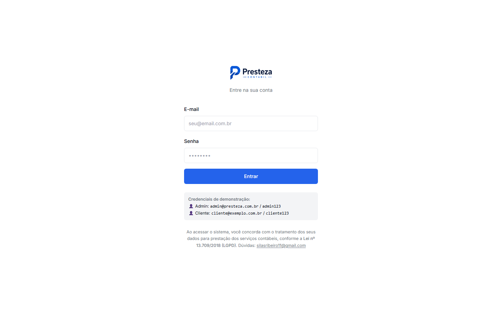
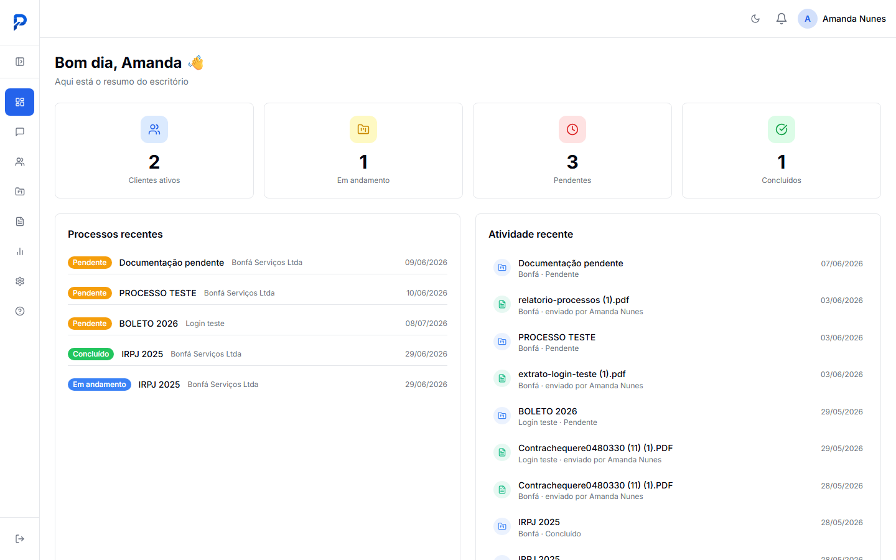
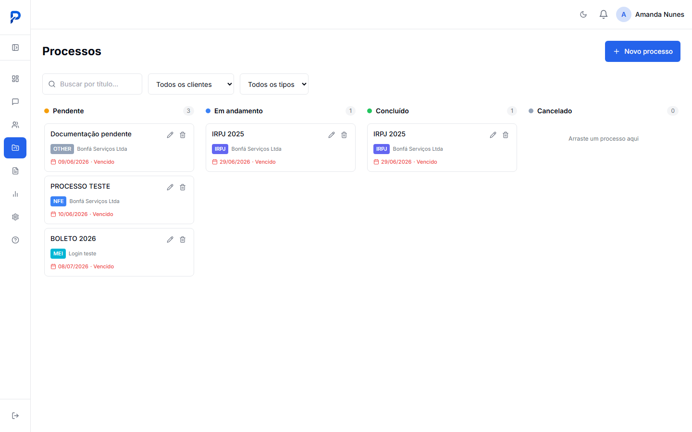
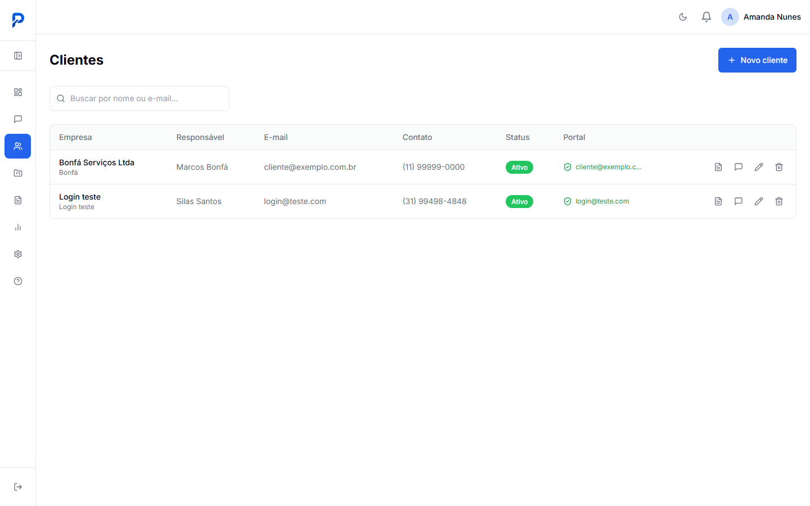
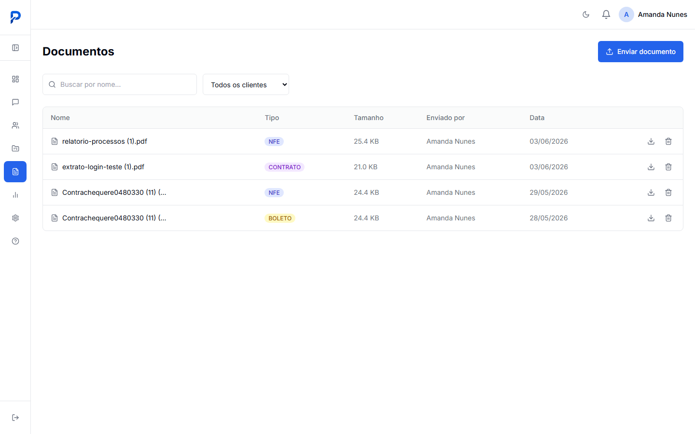
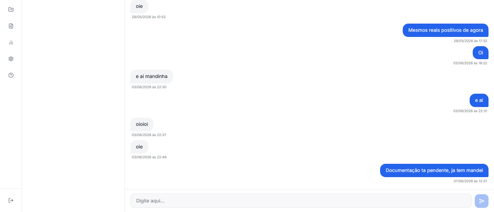
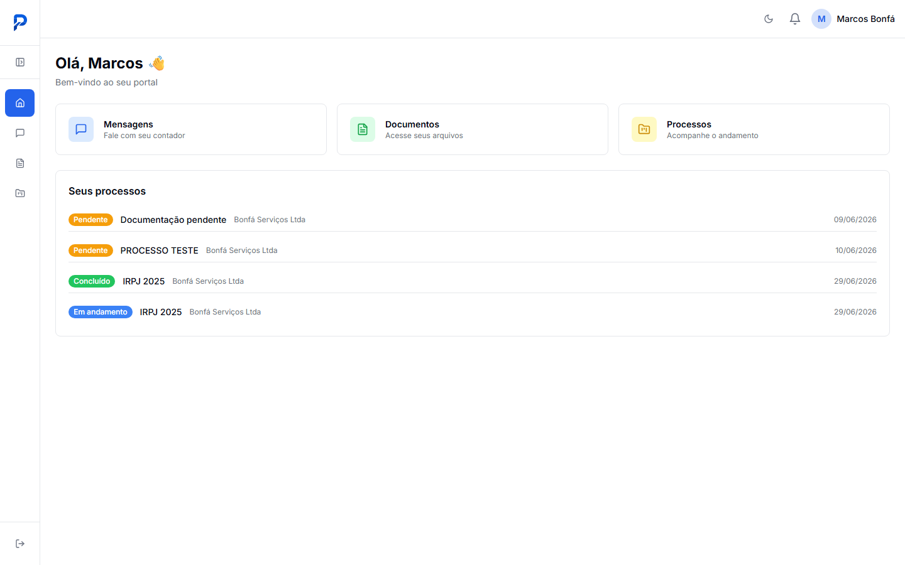

# Presteza Contábil

**Plataforma web para escritórios de contabilidade gerenciarem clientes, processos, documentos e comunicação em um único lugar — com portal próprio para o cliente final.**

---

## Sobre o projeto

Escritórios de contabilidade de pequeno e médio porte costumam depender de e-mail, WhatsApp e planilhas para acompanhar obrigações fiscais, trocar documentos e se comunicar com clientes — um processo fragmentado e sem rastreabilidade. O Presteza Contábil centraliza esse fluxo em uma aplicação única, com uma área administrativa para o escritório e um portal próprio para cada cliente acompanhar seus processos.

- **Para quem:** escritórios de contabilidade (área admin) e seus clientes pessoa jurídica (portal do cliente).
- **Status atual:** MVP funcional, em desenvolvimento ativo. Autenticação, CRUD de clientes, kanban de processos, upload de documentos, chat em tempo real, notificações e geração de relatórios em PDF já estão implementados e em uso com dados reais de demonstração.

---

## Prévia

| **Login** | **Dashboard administrativo** |
|---|---|
|  |  |

| **Processos (kanban)** | **Clientes** |
|---|---|
|  |  |

| **Documentos** | **Chat em tempo real** |
|---|---|
|  |  |

| **Portal do cliente** |
|---|
|  |

---

## Funcionalidades

**Gestão de clientes**
- Cadastro, edição e exclusão de clientes pessoa jurídica
- Linha do tempo de eventos por cliente
- Concessão de acesso ao portal do cliente

**Processos e obrigações**
- Quadro kanban por status (pendente, em andamento, concluído, cancelado)
- Criação, edição e movimentação de processos por arrastar e soltar
- Controle de vencimento com destaque visual para itens vencidos

**Documentos**
- Upload com armazenamento em nuvem (Cloudflare R2) e URLs assinadas
- Organização por cliente e por tipo de documento
- Download e exclusão

**Comunicação**
- Chat em tempo real entre escritório e cliente (WebSocket)
- Notificações em tempo real para novas mensagens, documentos e atualizações de processo
- Contador de não lidas no sino de notificações

**Relatórios**
- Extrato em PDF por cliente
- Lista de processos em PDF

**Acesso e segurança**
- Autenticação via JWT com dois perfis (administrador e cliente)
- Portal segregado por perfil, com rotas protegidas por middleware
- Aviso de tratamento de dados conforme a LGPD (Lei nº 13.709/2018)

---

## Arquitetura e stack

| Camada | Tecnologia |
|---|---|
| Frontend web | Nuxt 3 + Vue 3 + Pinia + Tailwind CSS |
| Backend | NestJS 10 + TypeScript |
| Banco de dados | PostgreSQL (Neon, serverless) + Prisma ORM |
| Comunicação em tempo real | Socket.IO (gateway NestJS + cliente Nuxt) |
| Armazenamento de arquivos | Cloudflare R2 (compatível com S3) |
| Geração de PDF | pdfmake |
| Monorepo | pnpm workspaces |
| Deploy | Railway (API) + Vercel (web) |

Uma ação típica do usuário — por exemplo, enviar uma mensagem no chat — percorre o seguinte caminho: o cliente Nuxt emite o evento via Socket.IO para o `ChatGateway` da API; a API persiste a mensagem no PostgreSQL via Prisma, cria uma notificação associada e republica ambos os eventos (mensagem e notificação) para a sala do destinatário; o front-end recebe o evento em tempo real pela store Pinia correspondente e atualiza a interface sem recarregar a página.

---

## Estrutura do projeto

```
presteza-contabil/
├── apps/
│   ├── api/                  # Backend NestJS
│   │   ├── src/
│   │   │   ├── auth/         # JWT, estratégias passport, guards
│   │   │   ├── clients/      # CRUD de clientes
│   │   │   ├── processes/    # Processos/obrigações (kanban)
│   │   │   ├── documents/    # Upload/listagem/download (R2)
│   │   │   ├── chat/         # Conversas, mensagens, gateway WS
│   │   │   ├── notifications/# Notificações em tempo real
│   │   │   ├── reports/      # Geração de PDF
│   │   │   └── storage/      # Integração com Cloudflare R2
│   │   └── prisma/           # Schema e seed do banco
│   └── web/                  # Frontend Nuxt
│       ├── pages/
│       │   ├── admin/        # Área do escritório (dashboard, kanban, clientes...)
│       │   └── portal/       # Área do cliente final
│       ├── stores/           # Pinia (auth, chat)
│       ├── components/       # Componentes compartilhados e de chat
│       └── middleware/       # Proteção de rotas por perfil
├── packages/
│   └── types/                # Tipos TypeScript compartilhados entre API e web
└── docs/                     # Documentação e material de apresentação
```

---

## Como rodar localmente

**Pré-requisitos:** Node.js 18+, pnpm, uma instância PostgreSQL (o projeto usa Neon) e uma conta Cloudflare R2 para upload de documentos.

```bash
# Instalar dependências do monorepo
pnpm install

# Configurar variáveis de ambiente
# apps/api/.env — DATABASE_URL, JWT_SECRET, credenciais R2
# apps/web/.env — não obrigatório em dev (usa localhost:3001 por padrão)

# Aplicar schema e popular o banco com dados de demonstração
cd apps/api
npx prisma db push
npx ts-node prisma/seed.ts

# Subir a API
npm run dev

# Em outro terminal, subir o frontend
cd apps/web
npm run dev
```

| Serviço | Porta | URL |
|---|---|---|
| API (NestJS) | 3001 | http://localhost:3001/api |
| Documentação Swagger | 3001 | http://localhost:3001/api/docs |
| Web (Nuxt) | 3000 | http://localhost:3000 |

**Credenciais de demonstração** (criadas pelo seed):
- Administrador: `admin@presteza.com.br` / `admin123`
- Cliente: `cliente@exemplo.com.br` / `cliente123`

---

Desenvolvido como projeto full-stack para gestão de escritórios de contabilidade.
